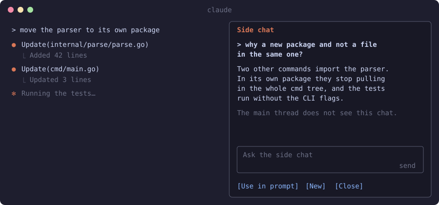

# side-chat

A Claude Code mod that opens a side chat beside the main chat. The side chat talks to a fork of the conversation: it knows everything the main thread knows, and the main thread does not see it.

Use it to ask a quick question about the work while Claude goes on with the main task, without a new turn in the main thread and without a change to its context.



The picture is drawn to match the terminal, not captured from it.

## Install

At the prompt of a Claude Code terminal session:

```
/plugin install side-chat --marketplace popoffvg/side-chat
```

Answer `y` to add the marketplace, then pick a scope (user scope is first).

From a shell:

```sh
claude plugin install side-chat --marketplace popoffvg/side-chat
```

In the desktop app: click **+** next to the prompt box, then **Plugins**, **Add marketplace** with `popoffvg/side-chat`, then **Add plugin**.

The mod needs a Claude Code build that loads mods (hooks modules).

## Usage

| Action | What it does |
| --- | --- |
| `/side` | Opens the side chat pane. |
| `/side <question>` | Opens the pane and asks the question. |
| type in the pane, then `send` | Asks the next question. The side chat keeps its own thread. |
| **Use in prompt** | Adds the last side-chat answer to the main prompt box. |
| **New** | Clears the side-chat thread. |
| **Close** or `Esc` | Closes the pane. The thread stays for the session. |

See [examples/](examples/) for sample sessions.

## How it works

```
/side <question>
   └─► $.agent.spawn({ subagentType: 'fork', prompt: side-chat turns so far + question })
          ├─ tool.check: a call of the fork outside the read-only table → deny; a read-only call that would ask → allow
          ├─ the fork reads files and runs read-only commands, in the background
          └─► agent.report: the answer goes into the pane; the main thread gets no notice
```

- The fork is a background subagent with the main conversation, its model, and its tools. The mod denies every call that is not read-only.
- Read-only tools: `Read`, `Grep`, `Glob`, `LSP`, `WebFetch`, `WebSearch`, `ToolSearch`, and `Bash` when Claude Code judges the command read-only (for example `git log`, `ls`). Edits, writes, agents, MCP tools, and other commands are denied. A read-only call runs without a permission prompt. A deny rule in your settings still blocks it.
- Before the first turn of a session, and after `/clear`, there is nothing to fork. The mod then starts the `Explore` agent with no history, and the pane says why the fork did not start before Explore answers.
- The side-chat thread is session state: it lives through a reload of the mod and ends with the session.

## Development

```sh
claude --plugin-dir ~/path/to/side-chat   # run a session with the mod loaded
claude plugin validate ~/path/to/side-chat
```

The engine writes the API types to `.claude-plugin/types/` when it loads the mod. Then `tsc -p .` type-checks it.

## License

[MIT](LICENSE)
